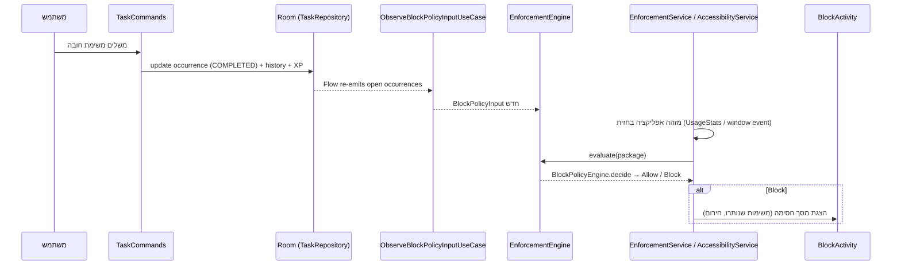

# ARCHITECTURE — DISCIPLINE OS ULTRA

## עקרונות
1. **Local-first / Offline-first** — כל הנתונים ב-Room + DataStore על המכשיר. אין צורך בשום שירות ענן כדי שהאפליקציה תעבוד.
2. **לוגיקה טהורה ונבדקת** — כל כללי המוצר (מדיניות חסימה, חזרתיות משימות, DST, טיימר, XP, סטטיסטיקה, אימות פעולות AI) יושבים במודולי Kotlin טהורים (`core:model`, `core:domain`) בלי תלות ב-Android. הם נבנים ונבדקים על כל JVM.
3. **שכבת Android דקה** — UI ב-Compose, אכיפה, התמדה ותזמון ממומשים מעל ממשקי ה-domain.
4. **דטרמיניזם** — "עכשיו" מגיע רק מ-`TimeProvider`. החלטת חסימה היא פונקציה טהורה של `BlockPolicyInput`. כל שינוי במשימות משנה את ה-Flow של ה-repository → הקלט למדיניות מתעדכן → ההחלטה מחושבת מחדש.
5. **פרטיות כברירת מחדל** — אין גיבוי ענן אוטומטי, אין שליחת רשימת אפליקציות או נתוני שימוש ל-AI בלי opt-in, אין מפתחות API ב-APK.

## מודולים

```mermaid
flowchart TB
  subgraph app[":app — Android (Compose, Hilt, Room, WorkManager)"]
    UI["ui/* — Dashboard, Tasks, Focus, Stats, Coach, Settings, Onboarding"]
    DS["designsystem — Theme, Tokens, Ds* components"]
    ENF["enforcement — EnforcementService, AccessibilityService (אופציונלי), BlockActivity, Permissions"]
    DATA["data — Room DB, DAOs, DataStore, Repos impl, Backup, SecureStore"]
    WORK["work + notifications — Materialize, Reminders, Daily summary"]
    AI["ai — SelectingAiCoachRepository, RemoteBackendCoachProvider"]
    FOC["focus — AlarmScheduler, Notifier, StateObserver"]
  end
  subgraph domain[":core:domain — Kotlin טהור"]
    TASK["task — RecurrenceEngine, DueInstantResolver, TaskCommands, DayPlan, SmartScheduler"]
    BLK["blocker — BlockPolicyEngine, ProtectedPackages, BypassManager, RecoveryMode"]
    FOCUS["focus — FocusTimerStateMachine, FocusSessionManager"]
    GAM["gamification — XP, Levels, Streaks, Achievements, WeeklyReview"]
    STATS["stats — StatisticsCalculator"]
    COACH["coach — PromptInjectionGuard, CoachActionValidator, CostGuard, LocalDemoCoach, Conversation"]
    REPO["repository — ממשקים בלבד"]
  end
  MODEL[":core:model — data classes משותפים"]
  BACKEND["backend/ (רפרנס, לא פרוס) — Supabase Edge Function → Claude API"]

  UI --> DS
  UI --> domain
  ENF --> BLK
  DATA -.implements.-> REPO
  WORK --> TASK
  AI -.implements.-> COACH
  FOC --> FOCUS
  domain --> MODEL
  AI -. HTTPS/SSE, opt-in .-> BACKEND
```

## זרימת החסימה (Blocker)

סדר ההחלטה ב-`BlockPolicyEngine.decide` (פונקציה טהורה):
1. חבילה מוגנת (טלפון, חירום, הגדרות, SystemUI, האפליקציה עצמה, חייגן/SMS/לאנצ'ר ברירת מחדל, חריגים של המשתמש) → **תמיד מותר**.
2. החוסם כבוי → מותר. 3. מצב התאוששות פעיל → מותר. 4. האפליקציה לא נבחרה → מותר.
5. שחרור זמני פעיל → מותר. 6. יש משימת חובה פתוחה (היום, או באיחור כש-carry-over פעיל) → **חסום**.
7. סשן ריכוז פעיל וההגדרה מופעלת → חסום. 8. אחרת → מותר (אין משימות חובה = אין חסימה).

## זמן, חזרתיות ו-DST
- משימה שומרת **תאריך מקומי + שעה מקומית + zoneId**. מופעים (occurrences) נוצרים לפי **תאריך מקומי** — אף פעם לא ע"י הוספת 24 שעות.
- `DueInstantResolver` ממיר לזמן מוחלט עם `ZonedDateTime.ofLocal`: שעה שנופלת ב"חור" של מעבר לשעון קיץ מוזזת קדימה; שעה כפולה במעבר לשעון חורף מקבלת את ה-offset המוקדם.
- `SystemTimeProvider` קורא את אזור הזמן של המערכת בכל קריאה, ו-`BootReceiver` מגיב ל-`TIMEZONE_CHANGED`/`TIME_SET`.
- הטיימר מבוסס timestamps (`phaseEndsAt`) — שורד מוות של התהליך ו-Doze.

## התמדה
Room (גרסה 2, schema מיוצא, מיגרציה 1→2 אמיתית) לטבלאות; DataStore להגדרות ולמצב הטיימר החי; Keystore (AES-GCM) לסודות קטנים. פירוט: `docs/DATABASE.md`.

## AI Coach
`AiCoachRepository` (ממשק) → `SelectingAiCoachRepository`: ספק דמו מקומי (ברירת מחדל, אופליין, דטרמיניסטי) או ספק מרוחק דרך backend בלבד (opt-in + URL מוגדר). כל פעולה שהמודל מציע עוברת `CoachActionValidator` (allow-list קשיח) ונכתבת רק אחרי לחיצת אישור של המשתמש. פירוט: `docs/AI_SECURITY.md`.

## Build
- `./gradlew -p verify-jvm test` — מודולי ה-domain בלבד (עובד בכל סביבה עם JDK).
- `./gradlew :app:assembleDebug` — build מלא (דורש Android SDK + גישה ל-Google Maven).
- CI: `.github/workflows/discipline-os-ultra.yml` מריץ את שניהם ומעלה את ה-debug APK כ-artifact.

## החלטות ארכיטקטורה (ADR מקוצר)
| החלטה | למה |
|---|---|
| מודול `:app` יחיד + 2 מודולי JVM טהורים | מספיק להפרדת אחריות ובדיקתיות; פחות תצורת Gradle שבירה. פיצול ל-feature modules אפשרי בהמשך. |
| UsageStats + overlay כמצב ברירת מחדל, Accessibility אופציונלי | עמידה במדיניות Google Play; Accessibility רק עם גילוי והסכמה. |
| אין SQLCipher | לא זמין ב-deps המאומתים; מסתמכים על הצפנת המכשיר + ללא גיבוי ענן. מתועד כ-trade-off. |
| גרסאות 2025 יציבות | היחידות שניתן היה לוודא תאימות הדדית; מומלץ עדכון מבוקר ב-CI. |
