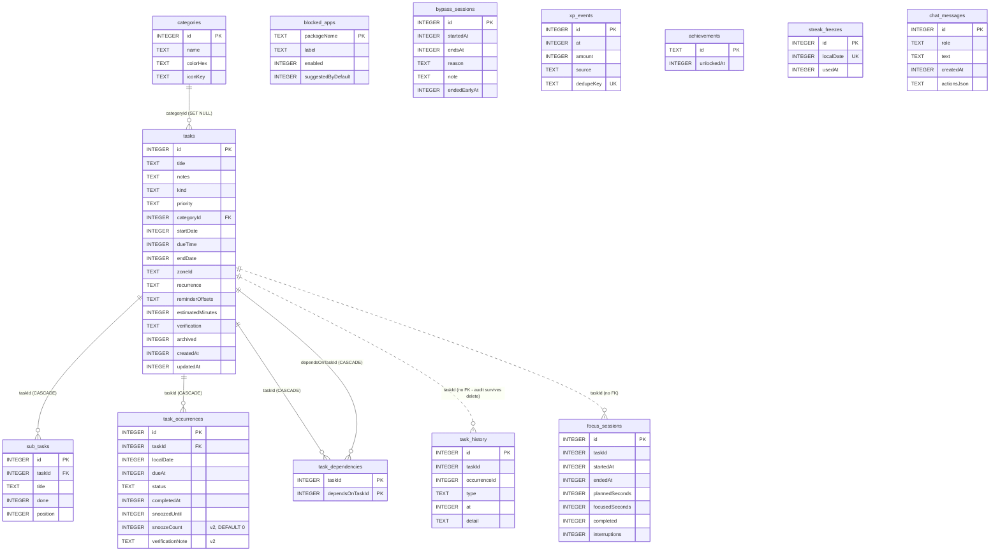

# DATABASE — local storage, migrations, backup and privacy

Owner: agent E (Data & Scheduling). Code: `app/src/main/kotlin/com/disciplineos/app/data/**`, `di/DataModule.kt`, `work/**`.

## 1. Storage map

| What | Where | Notes |
|---|---|---|
| Tasks, occurrences, sub-tasks, dependencies, categories, history | Room `discipline.db` | Source of truth for the task engine |
| Blocked apps, bypass log | Room | Bypass log = app-usage behaviour → never in backups |
| Focus sessions, XP events, achievements, streak freezes | Room | |
| Coach chat (actions as JSON) | Room `chat_messages` | Never in backups |
| `AppSettings`, `AiPrivacySettings` | Preferences DataStore `discipline_prefs` | One key per field |
| `BlockerConfig`, `FocusConfig`, running `FocusState` | same DataStore, JSON strings | `PrefsCodec`; corrupt value → defaults |
| Small secrets (per-install backend token) | same DataStore, AES-GCM ciphertext | `SecureStore`, key in Android Keystore |

Column encodings: `Instant` → epoch millis, `LocalDate` → epoch day (INTEGER, indexable, `BETWEEN`-friendly;
1970-01-01 … 9999-12-31 round-trips), `LocalTime` → second of day, enums → their `name` (TEXT) parsed with a
safe fallback in `data/mapper` so an unknown name never crashes a query. Recurrence is stored with
`RecurrenceCodec.encode`; reminder offsets as a comma list.

## 2. Schema (v2)



Key indices and the invariants they enforce:

- `task_occurrences (taskId, localDate)` **UNIQUE** → materialisation is idempotent (`INSERT OR IGNORE`).
- `task_occurrences (status, localDate)` → "open occurrences on or before D" (blocker / carry-over).
- `xp_events (dedupeKey)` **UNIQUE** → an award is never granted twice (`awardXp` returns `false`).
- `streak_freezes (localDate)` **UNIQUE**, `achievements.id` PK → idempotent per date / per achievement.

Rules in the DAO layer: tasks are never written with `REPLACE` (it deletes the row first and would cascade-delete
the task's occurrences); `@Upsert`/`@Update` are used instead. Relations (`occurrence + task + dependencies +
sub-tasks`) are loaded with `@Transaction` + `@Relation`, i.e. one query per relation, not per row.
`observeOpenOccurrences` returns PENDING **and** MISSED rows of non-archived tasks.

## 3. Migrations

Policy:

1. Every `version` bump ships an explicit `Migration` in `data/local/Migrations.kt` and is added to `Migrations.ALL`.
2. `fallbackToDestructiveMigration()` is **never** used (debug or release). A missing migration crashes on open in
   testing instead of silently deleting a user's data.
3. Each migration has a `MigrationTestHelper` test (`androidTest/.../data/MigrationTest.kt`), plus a test that opens
   the migrated file with the real compiled `DisciplineDatabase` — Room then validates the result against the
   generated entity code, catching drift between the JSON history and the entities.
4. A column added with `NOT NULL DEFAULT x` must carry `@ColumnInfo(defaultValue = "x")` on the entity, so a
   migrated DB and a fresh DB are identical (Room compares defaults).

History:

| Version | Change |
|---|---|
| 1 | Initial schema (13 tables). |
| 2 | `task_occurrences.snoozeCount INTEGER NOT NULL DEFAULT 0` (back-filled from the count of `SNOOZED` history rows per occurrence) and `task_occurrences.verificationNote TEXT`. |

### 3.1 Exported schema files and regeneration

`app/build.gradle.kts` sets `room { schemaDirectory("$projectDir/schemas") }`, so Room writes
`app/schemas/com.disciplineos.app.data.local.DisciplineDatabase/<version>.json` on every build and the Room Gradle
plugin packages that folder as androidTest assets for `MigrationTestHelper`.

**Honest status:** the repository was produced in a sandbox without Google Maven, so Room's compiler never ran.
`1.json` and `2.json` were **hand-written** to match the entities exactly (same `createSql`, fields, indices, FKs and
the `DEFAULT 0`). Their `identityHash` values (`e0a1…7e01`, `e0a1…7e02`) are **placeholders**.

On the first real build:

1. `./gradlew :app:kspDebugKotlin` (or any build). Room **overwrites `2.json`** with its own output and the real
   identity hash. Review the diff: only `identityHash`, the `setupQueries` hash and possibly whitespace/key order
   should change. Any change to `createSql`, fields, indices or foreign keys means the hand-written file was wrong —
   then `1.json` must be fixed the same way (v1 = v2 minus the two v2 columns).
2. `1.json` is **not** regenerated (Room only writes the current version). It stays hand-maintained; its placeholder
   hash is harmless because `MigrationTestHelper` writes and checks the hash from the same file.
3. Optional, for a real v1 hash: temporarily set `version = 1` and remove `snoozeCount`/`verificationNote` from
   `TaskOccurrenceEntity` (and their uses), build once, keep the generated `1.json`, revert. Not required.
4. Run `./gradlew :app:connectedDebugAndroidTest --tests '*MigrationTest*'` on a device/emulator.
5. Commit both JSON files. From then on never edit a released `<n>.json` by hand.

For the next schema change (v3): change entities, bump `DisciplineDatabase.VERSION`, add `MIGRATION_2_3` to
`Migrations.ALL`, build (Room writes `3.json`, `2.json` stays as history), add a test case to `MigrationTest`.

## 4. Backup format (`data/backup`)

`BackupManager.exportTo(uri)` / `importFrom(uri)` (Storage Access Framework URIs; the Settings screen asks for
confirmation before an import). JSON, UTF-8, pretty-printed:

```json
{
  "schemaVersion": 1,
  "app": "discipline-os",
  "exportedAt": "2026-11-04T20:00:00Z",
  "settings": { "language": "HEBREW", "onboardingCompleted": true, "notificationsEnabled": true,
                "dailyPlanningTime": "08:00", "weekStart": "SUNDAY", "reduceMotion": false, "highContrast": false },
  "blockerConfig": { "enabled": true, "carryOverOverdue": true, "blockDuringFocus": true, "bypassDurationMinutes": 10,
                     "maxBypassesPerDay": 3, "bypassCooldownMinutes": 30, "recoveryUntil": null, "userExemptPackages": [] },
  "focusConfig": { "workMinutes": 25, "shortBreakMinutes": 5, "longBreakMinutes": 15, "sessionsBeforeLongBreak": 4,
                   "autoStartBreaks": true, "autoStartWork": false },
  "categories": [ { "id": 1, "name": "...", "colorHex": "#FF5722", "iconKey": "heart" } ],
  "tasks": [ { "id": 10, "title": "...", "kind": "MANDATORY", "priority": "HIGH", "startDate": "2026-11-04",
               "dueTime": "18:00", "zoneId": "Asia/Jerusalem", "recurrence": "D1", "reminderOffsetsMinutes": [60, 10],
               "verification": "NONE", "dependsOn": [11], "subTasks": [ { "id": 100, "title": "...", "done": false, "position": 0 } ],
               "createdAt": "...", "updatedAt": "..." } ],
  "occurrences": [ ... ], "history": [ ... ], "blockedApps": [ ... ], "focusSessions": [ ... ],
  "xpEvents": [ ... ], "achievements": [ ... ], "streakFreezes": [ ... ]
}
```

Excluded by design: chat history, bypass log, AI privacy settings (an import must never silently turn on a remote
AI provider), secrets, the live focus timer.

Import validation (`BackupCodec.decode`, pure Kotlin, JVM-tested) — the whole file is rejected on the first problem:
size ≤ 5 MB (enforced while streaming), well-formed JSON, `app` marker, `schemaVersion == 1` (unknown → rejected),
row caps (100k per table, 10k tasks, 200 sub-tasks per task), string caps (title ≤ 500, notes ≤ 10 000, …),
valid enum names / ISO dates / time-zone ids / package names / colours, positive unique ids, referential integrity
(categories, dependencies, occurrences → tasks), uniqueness of `(taskId, localDate)`, `dedupeKey`, freeze dates.
Error messages carry a reason and a field path (`tasks[3].title`), never user content.

Import is transactional: all backed-up tables are emptied and refilled inside one Room transaction (any failure
rolls back). Preferences are written right after the commit (DataStore cannot join a SQLite transaction). Then an
immediate `MaterializeWorker` run re-creates the occurrence window and reschedules reminders. Ids are preserved.

## 5. Privacy and security notes

- **The Room database is not encrypted at the application level.** SQLCipher is not a dependency (size, native
  code, and key-management complexity for a single-user offline app). Protection relies on: Android file-based
  encryption of app-private storage (every Android 10+ device, including the S25 Ultra), the app sandbox,
  `android:allowBackup="false"`, `fullBackupContent="false"` and `data_extraction_rules.xml` excluding everything
  from cloud backup and device transfer. Trade-off: on a rooted/compromised device, or via a privileged process,
  the DB is readable. If that threat model becomes relevant, SQLCipher via `SupportOpenHelperFactory` can be added
  with a Keystore-wrapped key; that needs a one-time re-encryption migration.
- **SecureStore**: AES-256-GCM key generated inside the Android Keystore (non-exportable), random 12-byte IV per
  write, 128-bit tag. Only ciphertext reaches DataStore. Keystore loss ⇒ value unreadable ⇒ `get` returns null and
  the caller re-provisions. Values are never logged.
- **No logging of personal data**: no task titles, notes, chat text or package lists are logged. The app-scope
  exception handler logs only the exception class name. Backup errors carry field paths only.
- **Notifications**: titles appear only in the private body; the lock-screen public version is generic. The daily
  summary contains counts only. POST_NOTIFICATIONS is checked before every post.
- **Delete all my data** (`DataWipeRepository.wipeAll`): stops the focus timer, cancels all WorkManager work and
  visible notifications, clears every Room table, deletes SecureStore entries and the Keystore key, clears all
  preferences, then re-enqueues the (data-free) maintenance jobs.

## 6. Scheduling (WorkManager)

| Work | Type | When | Constraints |
|---|---|---|---|
| `materialize-daily` (`MaterializeWorker`) | periodic 24h, KEEP | first run ≈00:15 local | battery not low |
| `materialize-now` | one-time, REPLACE | app start, after import | none |
| `daily-summary` (`DailySummaryWorker`) | periodic 24h, KEEP | first run ≈20:30 local | none |
| `reminder-<occId>-<offset>` (`ReminderWorker`) | one-time, REPLACE | `dueAt` (or end of local day) − offset; `snooze` = snoozedUntil | none |

`MaterializeWorker`: `materializeWindow()` → `sweepPast(blockerConfig.carryOverOverdue)` →
`checkDayCleared(yesterday)` → `rescheduleAll()`; all steps idempotent. Reminders are planned for the next 48 h
(`ReminderPlanner`, pure and JVM-tested); stale queued reminders are cancelled, unchanged ones are not re-enqueued.
Periodic jobs can drift by WorkManager's flex window and by an hour across DST — acceptable for maintenance;
reminders are exact one-time jobs (subject to Doze batching of a few minutes).
