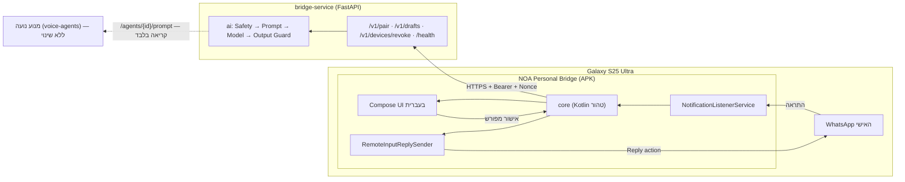
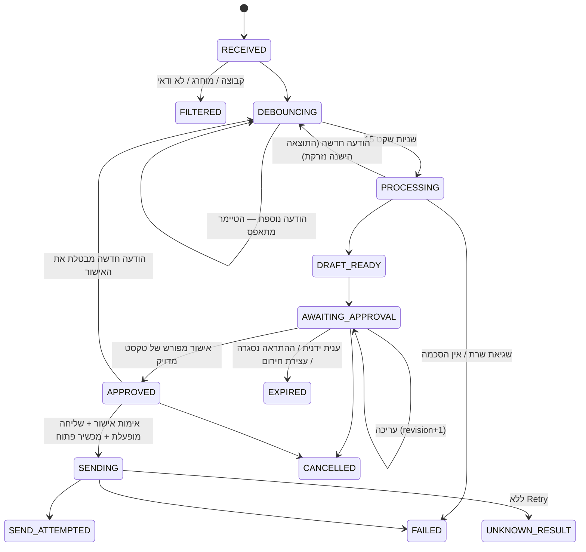

# ארכיטקטורה — NOA Personal Bridge

## במשפט אחד
אפליקציית Android קוראת (בהרשאה מפורשת) התראות של WhatsApp האישי משיחות פרטיות, ממתינה 15 שניות מההודעה האחרונה, מבקשת מנועה טיוטת תשובה דרך שרת גשר מבודד, ומציגה אותה לאישור. רק אחרי אישור מפורש בתוך האפליקציה מתבצע ניסיון שליחה **אחד**, דרך כפתור ה־Reply הרשמי שבהתראה של WhatsApp.

## שלושת הרכיבים

### 1. אפליקציית Android — `noa-personal-bridge/android`
| מודול | תפקיד |
|---|---|
| `core` | Kotlin טהור, בלי Android. מכיל את **כל** כללי הבטיחות: סינון, זיהוי קבוצות, Dedup, Debounce לכל שיחה, State Machine, אישורים, והמתזמר `BridgeCoordinator`. נבדק ביחידה על JVM. |
| `app/platform` | `NoaNotificationListenerService`, `NotificationMapper`, `ReplyActionRegistry`, `RemoteInputReplySender`, `BridgeApiClient`, אחסון מוצפן (Android Keystore), `DraftNotifier`, `DefaultAppController`. |
| `app/ui` | Jetpack Compose + Material 3, עברית ו־RTL כפוי, `FLAG_SECURE`. מדבר רק עם הממשק `AppController`. |

### 2. שירות הגשר — `noa-personal-bridge/bridge-service`
FastAPI מבודד. אחריות: אימות מכשיר (Pairing חד־פעמי → טוקן שנשמר כ־SHA-256), הגנת Replay (Timestamp + Nonce), Rate Limit, Idempotency לפי `request_id`, מגבלות גודל, Kill Switch (`BRIDGE_ENABLED`), ו־Health בלי תוכן. **לא שומר ולא מתעד תוכן הודעות.** אין לו שום יכולת לשלוח WhatsApp.

### 3. מתאם נועה — `bridge_service/ai`
| מנוע | מה עושה | עלות |
|---|---|---|
| `stub` (ברירת מחדל) | תשובות עבריות דטרמיניסטיות, בלי רשת | חינם |
| `anthropic` | Claude דרך Messages API, **בלי פרמטר `tools`** | לפי שימוש — דורש מפתח שהמשתמש מגדיר |
| `noa_persona` | שואל את הפרסונה של נועה מ־`POST /agents/{id}/prompt` (קריאה בלבד, Cache ל־10 דקות), ואז אותה קריאת Claude ללא כלים. נופל חזרה לפרסונה מובנית אם נועה לא זמינה | כמו `anthropic` |

**אסור לחלוטין:** `POST /agents/{id}/chat` — הוא מריץ כלים אמיתיים במנוע נועה (ראו D-003).

שכבות הבטיחות בכל מנוע: `safety.analyze_incoming` (זיהוי Injection ובקשות רגישות) → `prompt.build_messages` (הודעות עטופות כ־Untrusted, ניטרול תגיות) → המודל → `output_guard.finalize` (הסרת סודות, קישורים זרים, דליפת הוראות, אורך).

## זרימת הודעה ו־State Machine

כללים שנאכפים בקוד (`DraftStateMachineImpl`, `DefaultBridgeCoordinator`):
- אין מעבר ל־`SENDING` אלא מ־`APPROVED`. אין מעבר `DRAFT_READY → APPROVED`.
- כל הודעה חדשה בשיחה הופכת טיוטה קיימת ל"מתיישנת": מבטלת בקשה פעילה, מוחקת אישור, ומעלה את `revision`.
- אישור = טוקן חד־פעמי עם תוקף של 2 דקות, קשור ל־(טיוטה, revision, שיחה, SHA-256 של הטקסט).
- `sendApproved` צורך את הטוקן **לפני** השליחה, כך שגם קריאה כפולה במקביל שולחת לכל היותר פעם אחת.
- תוצאה לא ידועה → `UNKNOWN_RESULT`, בלי ניסיון חוזר.

## גבולות אמון

| מקור | רמת אמון | טיפול |
|---|---|---|
| טקסט ההודעות ושם השולח | **לא מהימן** | עטוף בתגיות, מנוטרל, לעולם לא הוראה; לא נרשם בלוגים |
| התראת WhatsApp (מבנה) | חלקי | Fail-closed בכל ספק |
| המשתמש באפליקציה | מהימן | רק הוא מאשר; נדרש מכשיר לא נעול |
| שרת הגשר | מהימן חלקית | TLS + טוקן; לא יכול לשלוח הודעות |
| פרסונת נועה מ־`/prompt` | מהימנה חלקית | רקע לטון בלבד; כללי הגשר גוברים עליה |

## מה הארכיטקטורה **לא** עושה
- לא משנה את נועה, את המספר שלה, את WhatsApp האישי, ולא מבצעת מיגרציה ל־WhatsApp Business.
- לא קוראת קבוצות, לא שומרת היסטוריה מלאה, לא מעלה אנשי קשר, לא שולחת אוטומטית.
- לא משתמשת ב־Accessibility Service, ב־WhatsApp Web או בספריות לא רשמיות.
