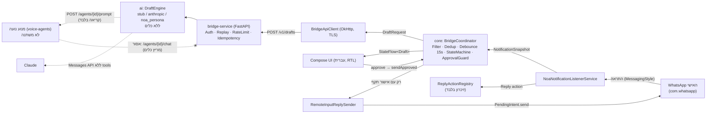
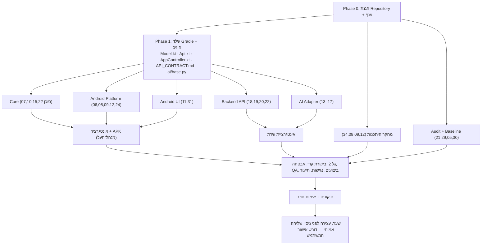

# גרף תלויות — משימות ורכיבים

## תלויות בין רכיבים (Runtime)

## תלויות בין משימות (Build)

## בעלות על קבצים (מונעת עריכה כפולה)

| נתיב | בעלים | הערות |
|---|---|---|
| `android/core/src/main/.../Model.kt`, `Api.kt` | 04 (אדריכל) | חוזה — שינוי חתימה רק דרך `DECISION_LOG.md` |
| `android/core/**` (שאר) | צוות Core | |
| `android/app/.../AppController.kt` | 04 (אדריכל) | חוזה UI↔Platform |
| `android/app/.../platform/**`, `BridgeApplication.kt`, `AndroidManifest.xml`, `res/xml/**`, `src/debug/**` | צוות Platform | |
| `android/app/.../ui/**`, `MainActivity.kt`, `res/values*/**`, `res/drawable/**`, `res/mipmap*/**` | צוות UI | |
| `android/*.gradle.kts`, `gradle/**` | מנהל־העל (30) | הוספת תלויות בתיאום |
| `bridge-service/bridge_service/ai/base.py` | 04 (אדריכל) | חוזה |
| `bridge-service/bridge_service/ai/**` | צוות AI | |
| `bridge-service/` (שאר) | צוות Backend | |
| `noa-personal-bridge/API_CONTRACT.md` | 04 (אדריכל) | |
| `docs/noa-personal-bridge/ANDROID_FEASIBILITY.md` | צוות מחקר (34) | |
| `docs/noa-personal-bridge/EXISTING_SYSTEM_AUDIT.md`, `INTEGRATION_PLAN.md`, `BASELINE_REGRESSION.md` | צוות Audit (21,29) | |
| שאר `docs/noa-personal-bridge/*` | מנהל־העל / תיעוד (32) | |
| כל קובץ קיים מחוץ ל־`noa-personal-bridge/` ו־`docs/noa-personal-bridge/` | **אסור לשינוי** | למעט קובץ CI חדש |
