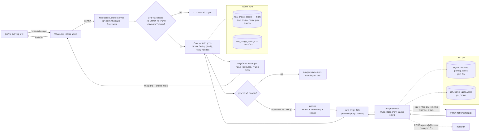

# פרטיות — NOA Personal Bridge

צוות האבטחה והפרטיות (Agent 25 Privacy Engineer, בשיתוף Agents 23, 24, 26). תאריך: 2026-11-15.
המסמך מתאר מה המערכת עושה בפועל לפי הקוד (לא לפי כוונות), איפה כל פריט מידע נמצא ולכמה זמן,
ומה המשתמש והאנשים שכותבים לו צריכים לדעת. ממצאי האבטחה המלאים נמצאים ב־[`SECURITY.md`](SECURITY.md).

> **זה לא ייעוץ משפטי.** סעיף 8 הוא הערות מעשיות של צוות הנדסה לגבי תיקון 13 לחוק הגנת הפרטיות.
> לפני שימוש שאינו ניסוי אישי מצומצם, מומלץ להתייעץ עם עורך/ת דין שמתמחה בדיני פרטיות.

---

## 1. בקצרה

- האפליקציה קוראת התראות של WhatsApp האישי (רק אחרי שהמשתמש נתן Notification Access בהגדרות המערכת),
  ומשאירה רק שיחות פרטיות שזוהו בוודאות. קבוצות, WhatsApp Business ו־WhatsApp השני (Dual Messenger) נדחים.
- **בלי הסכמה מפורשת בתוך האפליקציה ("עיבוד בענן") שום תוכן לא יוצא מהטלפון.**
- עם הסכמה: טקסט ההודעות הנכנסות האחרונות משיחה אחת + שם התצוגה של השולח נשלחים לשרת הגשר, ומשם לספק
  מודל השפה (Anthropic). השרת לא שומר תוכן בדיסק ולא מתעד אותו בלוגים.
- מנוע נועה **לא** מקבל שום תוכן שיחה — רק בקשה לקריאת הפרסונה (כשמנוע `noa_persona` פעיל).
- כל המידע על הטלפון נמצא בזיכרון בלבד, חוץ מפרטי החיבור וההחרגות שנשמרים מוצפנים.
- יש פערים ידועים: `conversation_ref` הוא Hash הפיך של מספר הטלפון (בניגוד לנוסח ההסכמה), ונקודת סיום ה־TLS
  (Tunnel / Reverse proxy) רואה את התוכן. פירוט בסעיף 9.

---

## 2. אילו נתונים מעובדים, ואיפה

| פריט מידע | מקור | טלפון — זיכרון | טלפון — דיסק | שרת — זיכרון | שרת — דיסק | ספק המודל | מנוע נועה |
|---|---|---|---|---|---|---|---|
| טקסט הודעות נכנסות (עד 20 אחרונות, ≤2000 תווים כל אחת, ≤8000 סה"כ) | צד שלישי | כן | לא | כן, בזמן העיבוד | **לא** | כן (עם הסכמה) | **לא** |
| שם התצוגה של השולח (כפי ששמור באנשי הקשר, או Push Name) | ספר הטלפונים / צד שלישי | כן | מוצפן — רק אם השיחה הוחרגה | כן, בזמן העיבוד | לא | כן | לא |
| מספר טלפון / JID | WhatsApp | כן (בתוך ההתראה) | לא | **כ־Hash הפיך** (`conversation_ref`) | לא | לא | לא |
| שעת שליחה של כל הודעה (`sent_at`) | WhatsApp | כן | לא | כן, בזמן העיבוד | לא | רק כזמן יחסי ("לפני 5 דקות") | לא |
| טקסט הטיוטה (מוצעת / ערוכה) | המודל / המשתמש | כן | לא | ב־Cache של Idempotency, 10 דקות | לא | (נוצר שם) | לא |
| שם הבעלים (`BRIDGE_OWNER_DISPLAY_NAME`) | המפעיל | — | — | כן | משתנה סביבה | כן | לא |
| פרסונת נועה (System prompt) | מנוע נועה | — | — | Cache 10 דקות | לא | כן | (מקור) |
| טוקן מכשיר | השרת | כן | מוצפן (AES-GCM, Keystore) | — | רק SHA-256 | לא | לא |
| מזהה מכשיר, שם מכשיר (דגם), זמני יצירה / שימוש אחרון / ביטול | השרת / הטלפון | — | מזהה מוצפן | — | כן (SQLite) | לא | לא |
| כתובת IP של הטלפון | רשת | — | — | במגביל הצימוד, עד שעה | לא (אלא אם לוגים של Proxy) | לא | לא |
| הודעות שהמשתמש עצמו שלח | WhatsApp | כן (לזיהוי "ענית ידנית") | לא | **לא נשלחות** | לא | לא | לא |
| הודעות מקבוצות | WhatsApp | נדחות מיד, לא נשמרות | לא | לא | לא | לא | לא |
| תמונות, קבצים, הקלטות | — | רק הטקסט שבהתראה (למשל "📷 תמונה") | לא | אותו טקסט בלבד | לא | אותו טקסט בלבד | לא |

---

## 3. זרימת המידע



---

## 4. שמירת מידע לפי מיקום

### 4.1 טלפון — זיכרון (נמחק תמיד במוות התהליך, באתחול, ב"מחיקת נתונים")
| מה | כמה זמן / כמה | איפה בקוד |
|---|---|---|
| טיוטות פעילות (הודעות מקור, שם שולח, טקסט טיוטה) | עד שהטיוטה מסתיימת; עד 30 פעילות; עד 20 הודעות לטיוטה | `DefaultBridgeCoordinator` (`MAX_ACTIVE_DRAFTS`, `MAX_MESSAGES_PER_DRAFT`) |
| טיוטות שהסתיימו (נשלחה / בוטלה / פגה / נכשלה) — **כולל התוכן** | עד שעה, עד 50 | `TERMINAL_RETENTION_MILLIS`, `MAX_TERMINAL_DRAFTS` (ממצא L-7: מומלץ למחוק תוכן במעבר למצב סופי) |
| Dedup — Hash של הודעות בלבד | 6 שעות, עד 2,000 | `Deduplicator.create` |
| אישורים (טוקן + Hash של הטקסט) | 2 דקות | `ApprovalGuard.create` |
| Reply handles של WhatsApp (PendingIntent, בלי תוכן) | עד שההתראה נסגרת / ניסיון שליחה אחד; עד 50 | `ReplyActionRegistry` |
| טקסט בעריכה במסך הטיוטה | כל עוד ה־Activity קיימת (Saved state של המערכת) | `DraftDetailScreen` (`rememberSaveable`) |
| ההתראה שלנו ("טיוטה מוכנה לאישור", עם שם השולח בגרסה הפרטית) | עד שהטיוטה כבר לא ממתינה | `DraftNotifier` |
| לוח העתקה (רק אם בחרת "העתק") | עד שמעתיקים משהו אחר; היסטוריית הלוח של המקלדת עשויה לשמור | `copyToClipboard` (מסומן רגיש ב־Android 13+) |

### 4.2 טלפון — דיסק
| קובץ | תוכן | הגנה |
|---|---|---|
| `shared_prefs/noa_bridge_secure.xml` | טוקן מכשיר, מזהה מכשיר, כתובת השרת, רשימת החרגות (מפתח שיחה + **שם תצוגה**) | כל ערך מוצפן AES-256-GCM במפתח AndroidKeyStore שאינו ניתן לייצוא; מוחרג מגיבוי ומהעברת מכשיר |
| `shared_prefs/noa_bridge_settings.xml` | דגלים: מושהה, עצירת חירום, הסכמה, שליחה ניסיונית | לא מוצפן (אין מידע אישי); מוחרג מגיבוי |
| `shared_prefs/noa_ui_onboarding.xml` | "האונבורדינג הושלם", "בקשת הרשאת התראות הוצגה" | לא מוצפן; אין מידע אישי; לא נמחק ב"מחיקת נתונים" |
| Logcat | שמות אירועים וקודים בלבד (`SafeLog`) | אין תוכן, שמות, מספרים או טוקנים |

**אין** מסד נתונים, קבצי מטמון או היסטוריית הודעות על הטלפון.

### 4.3 שרת — זיכרון
| מה | כמה זמן |
|---|---|
| גוף הבקשה (הודעות, שם שולח, `conversation_ref`) | משך העיבוד (שניות); לא נשמר אחר כך |
| Cache של Idempotency — **התשובה** (טקסט הטיוטה + דגלי בטיחות) לפי `(device_id, request_id)` | 10 דקות (`BRIDGE_IDEMPOTENCY_TTL_SECONDS`); נמחק ב־Revoke |
| Nonces (מזהה מכשיר + UUID) | 10 דקות |
| מוני קצב (מזהה מכשיר; IP למגביל הצימוד) | עד 24 שעות למכשיר, שעה לצימוד |
| פרסונת נועה | 10 דקות (60 שניות בכישלון) |

### 4.4 שרת — דיסק
| מה | כמה זמן |
|---|---|
| טבלת `devices`: מזהה, SHA-256 של הטוקן, שם מכשיר (דגם), זמן יצירה, **זמן שימוש אחרון** (ברזולוציה של דקה), זמן ביטול | **ללא הגבלה** — Revoke רק מסמן `revoked_at`; השורה נשארת עד שהמפעיל מוחק את הקובץ (ממצא L-10) |
| טבלת `pairing_codes`: SHA-256 של הקוד וזמנים | עד 24 שעות אחרי פקיעה |
| לוג JSON ל־stderr: אירוע, שיטה, נתיב, סטטוס, זמן תגובה, 8 תווים ממזהה המכשיר, `request_id` | לפי הגדרת המפעיל (journald / Docker). אין תוכן. |
| משתני סביבה: מפתחות API, שם הבעלים | קבוע, באחריות המפעיל |

### 4.5 גורמים חיצוניים
| גורם | מה מקבל | שמירה |
|---|---|---|
| ספק המודל (Anthropic, Messages API) | הנחיית מערכת (כולל שם הבעלים ופרסונה), טקסט ההודעות, שם השולח | לפי התנאים המסחריים של הספק. נכון לכתיבה, הספק מצהיר שאינו מאמן מודלים על נתוני API מסחריים כברירת מחדל ושומר נתונים לתקופה מוגבלת לצורכי אמון ובטיחות — **יש לאמת את המדיניות העדכנית**, ולשקול הסכם Zero Data Retention. ניסיון חוזר אחד (`max_retries=1`) שולח את אותו תוכן שוב. |
| נקודת סיום TLS (Reverse proxy / Tunnel) | **כל הבקשה בטקסט גלוי**, כולל ה־Bearer token | לפי הספק. אם זה שירות Tunnel של צד שלישי — הוא Processor לכל דבר (ממצא M-5). |
| מנוע נועה | `POST /agents/{id}/prompt` עם `{"variables": {}, "direction": "inbound"}` בלבד | לפי הלוגים של נועה; אין תוכן שיחה |
| WhatsApp / Meta | התשובה שאושרה נשלחת דרך האפליקציה הרשמית, כמו הקלדה ידנית | כמו כל הודעה |

---

## 5. תהליך ההסכמה

1. **הרשאת מערכת:** המשתמש מעניק Notification Access ידנית בהגדרות Android (האפליקציה רק פותחת את המסך).
   זו הסכמה לקריאה מקומית בלבד.
2. **אונבורדינג:** מסך שמסביר מה האפליקציה עושה. אפשר לדלג על ההסכמה — האפליקציה עובדת, אבל לא נוצרות טיוטות.
3. **הסכמה לעיבוד בענן:** דיאלוג גילוי (`ConsentDisclosureDialog`) שמפרט מה נשלח, לאן, ומה השליטה — ורק
   "אני מסכים/ה" מפעיל את `cloudConsentGiven`. בלי זה, ה־Engine wrapper ב־`DefaultAppController` מחזיר כישלון בלי
   שום קריאה לרשת, והטיוטה מסומנת "לא ניתנה הסכמה".
4. **שליחה ניסיונית:** מתג נפרד, כבוי כברירת מחדל, עם אזהרה. בלעדיו — רק "העתק טיוטה".
5. **כל שליחה:** אישור מפורש של הטקסט המדויק והנמען, על מכשיר לא נעול.
6. **ביטול הסכמה:** מיידי ובלי דיאלוג ביניים (`SettingsScreenTest.revokingConsentIsImmediate`); ה־Engine wrapper בודק את
   ההסכמה בכל בקשה, כך שהבקשה הבאה כבר לא יוצאת (`DefaultAppControllerTest.engineRefusesWithoutCloudConsent`).

```mermaid
sequenceDiagram
    participant U as המשתמש
    participant OS as Android
    participant App as האפליקציה
    participant S as שרת הגשר
    U->>OS: מעניק Notification Access
    OS-->>App: Listener מחובר (קריאה מקומית בלבד)
    App->>U: דיאלוג גילוי: מה נשלח, לאן, שליטה
    alt לא עכשיו
        App-->>App: אין יציאת תוכן; טיוטות נכשלות מקומית
    else אני מסכים/ה
        App->>S: רק אחרי 15 שניות שקט ורק לשיחה פרטית שלא הוחרגה
    end
    U->>App: (אופציונלי) מפעיל שליחה ניסיונית — אזהרה נפרדת
    U->>App: מאשר טקסט מדויק במכשיר פתוח
    App->>OS: ניסיון Reply אחד ב־WhatsApp
```

**פער בנוסח:** דיאלוג ההסכמה אומר "לא נשלחים מספרי טלפון" (`strings.xml:215`), אבל `conversation_ref` הוא Hash שאפשר
להפוך למספר בתוך כדקה (ממצא M-4). כמו כן הנוסח לא מציין במפורש את שם ספק המודל ואת נקודת סיום ה־TLS.
עד לתיקון מומלץ לעדכן את הנוסח: "נשלח מזהה מוצפן־חלקית של השיחה שאפשר לקשר למספר", "ספק המודל: Anthropic",
"השרת נגיש דרך <שם ה־Proxy/Tunnel>".

---

## 6. שליטת המשתמש

| פעולה | איפה | מה היא עושה (לפי הקוד) | מה היא **לא** עושה |
|---|---|---|---|
| **השהיה** | מסך הבית | ה־Filter דוחה כל התראה (`PAUSED`) לפני שנשמר משהו; טיוטות פעילות פגות; אין שליחה | לא מוחקת פרטי חיבור או החרגות |
| **עצירת חירום** | מסך הבית (עם אישור) | מבטלת טיימרים ובקשות בדרך, מפקיעה את כל הטיוטות, מוחקת את כל ה־Reply handles, מכבה את השליחה הניסיונית ושומרת את המצב. חידוש דורש אישור, והשליחה נשארת כבויה | לא מבטלת את החיבור לשרת |
| **החרגת שיחה** | מסך טיוטה (עם אישור) | שומרת את מפתח השיחה + שם תצוגה מוצפנים; מבטלת את כל הטיוטות של השיחה ומוחקת את ה־Handle; מעכשיו ההתראות של השיחה נדחות **לפני** שנשמר תוכן | **אפשר להחריג רק אחרי שהגיעה הודעה מהשיחה.** אם עברו 15 השניות וניתנה הסכמה, הפרץ הראשון כבר נשלח לשרת ולמודל. אין מצב "רשימה מותרת" (Allowlist) — מומלץ להוסיף |
| **ביטול הסכמה לעיבוד בענן** | הגדרות → פרטיות | שום בקשה חדשה לא יוצאת מהטלפון | לא מוחק את מה שכבר עובד אצל ספק המודל |
| **מחיקת נתונים מקומיים** | הגדרות (עם אישור) | מוחקת טיוטות, Handles, ההתראות שלנו, הקובץ המוצפן **ומפתח ה־Keystore**, וההגדרות | **לא מבטלת את הטוקן בשרת** (ממצא L-5) — להשתמש קודם ב"ניתוק מלא"; לא מוחקת את דגלי האונבורדינג (אין בהם מידע אישי) |
| **ניתוק מלא** | הגדרות (עם אישור) | `POST /v1/devices/revoke` (הטוקן נפסל, ה־Cache של המכשיר נמחק מזיכרון השרת) ומחיקת פרטי החיבור מהטלפון | אם אין רשת — הביטול בשרת נכשל בשקט והאפליקציה עדיין מדווחת שנותקה (L-5); שורת המכשיר נשארת בדיסק השרת כ־revoked |
| **ביטול Notification Access** | הגדרות Android | האפליקציה מפסיקה לקבל התראות מיד | — |
| **הסרת האפליקציה** | Android | מוחקת את כל הנתונים המקומיים ואת מפתח ה־Keystore | לא מבטלת את הטוקן בשרת |
| **מתג השרת** (מפעיל) | `BRIDGE_ENABLED=false` / `BRIDGE_KILL_SWITCH_FILE` / `admin revoke-device` | עוצר צימוד וטיוטות; Revoke עובד גם כשכבוי | — |

---

## 7. צדדים שלישיים — האנשים שכותבים למשתמש

האנשים שכותבים למשתמש **לא נתנו הסכמה** לעיבוד ההודעות שלהם במערכת. זה הלב של הסיכון הפרטי כאן.

- **ציפייה סבירה:** מי שכותב בצ'אט פרטי מצפה שהמשתמש יקרא — לא ששרת ומודל שפה בענן יקראו. גם אם המשתמש הוא
  הנמען החוקי, העברה לספק חיצוני היא שימוש נוסף.
- **מידע רגיש:** שיחות פרטיות כוללות לעיתים מידע רפואי, משפחתי, כלכלי, מיקום, קודי אימות. ה־Filter בטלפון לא
  מסנן לפי נושא; זיהוי הבטיחות בשרת רק **מסמן** ולא חוסם שליחה למודל. מומלץ להחריג אנשי קשר שמשתפים מידע כזה
  (רופאים, עורכי דין, בני משפחה במצב רגיש) — ועדיף מראש, ברגע שתהיה אפשרות Allowlist.
- **קטינים:** אם ילדים כותבים למשתמש — להחריג את השיחות שלהם.
- **הודעות שנמחקו / נעלמות / "צפייה חד־פעמית":** אם הפרץ כבר נשלח לפני שהשולח מחק, התוכן כבר עבר לשרת ולספק.
  בטלפון, הסרת ההתראה מפקיעה את הטיוטה, אבל התוכן נשאר בזיכרון עד שעה (L-7). "צפייה חד־פעמית" לא מגיעה כטקסט.
- **הטיוטה מדברת בשם המשתמש:** ההנחיה למודל היא לכתוב בגוף ראשון ולא לציין שזה AI. המשתמש מאשר כל הודעה, ולכן
  זו הודעה שלו — אבל אנשים קרובים עשויים לרצות לדעת שחלק מהתשובות מנוסחות בעזרת כלי (סעיף 10).
- **אנשי קשר מחו"ל:** תושבי האיחוד האירופי, למשל, מוגנים ב־GDPR. המערכת מיועדת לשימוש אישי; לא נבחנה התאמה ל־GDPR.
- **התנגדות:** אם מישהו מבקש לא להיות חלק מזה — להחריג את השיחה מיד ולא להשתמש בכלי בשיחה איתו.
- **אין פרופיילינג:** המערכת לא שומרת היסטוריה ולא בונה פרופיל לאנשי קשר. כל בקשה עומדת בפני עצמה.

---

## 8. תיקון 13 לחוק הגנת הפרטיות — הערות מעשיות (לא ייעוץ משפטי)

תיקון 13 לחוק הגנת הפרטיות, התשמ"א־1981, נכנס לתוקף באוגוסט 2025. ההערות הבאות הן הקריאה ההנדסית שלנו
של המשמעויות למערכת כזאת, ולא חוות דעת:

1. **האם זה "מאגר מידע"?** החוק מחריג אוסף מידע לשימוש אישי שאינו למטרות עסק. אם המשתמש משתמש בגשר גם
   בשיחות עסקיות (למשל לקוחות של העסק — הקשר של נועה), ייתכן שההחרגה לא חלה. כדאי להחליט מראש: שימוש
   אישי בלבד, או שימוש עסקי עם כל החובות.
2. **הגדרות רחבות יותר:** התיקון מרחיב את הגדרת "מידע אישי" וקובע קטגוריה של "מידע בעל רגישות מיוחדת"
   (למשל בריאות, מידע גנטי וביומטרי, השקפות ואמונות, מוצא, עבר פלילי, נטייה מינית, מיקום). גם Hash הפיך
   (כמו `conversation_ref`) עשוי להיחשב מידע אישי, כי אפשר לזהות דרכו אדם.
3. **סמכויות אכיפה:** לרשות להגנת הפרטיות סמכויות פיקוח וחקירה מורחבות והטלת עיצומים כספיים. לצד זה קיימים
   הסעדים האזרחיים, כולל פיצוי בגין פגיעה בפרטיות.
4. **חובת יידוע ושקיפות:** במידה שהחוק חל, יש לוודא שהנוסח שמוצג (למשתמש, ובמידת הצורך גם לאנשי הקשר)
   מדויק. פערי הנוסח בסעיף 5 חשובים כאן.
5. **צמצום מידע והגבלת מטרה:** המערכת כבר שולחת רק את הפרץ האחרון, בלי היסטוריה, בלי קבוצות, ובלי שמירה בדיסק.
   להמשיך כך, ולא להוסיף "זיכרון" לשיחות.
6. **אבטחת מידע:** תקנות הגנת הפרטיות (אבטחת מידע), התשע"ז־2017 — אם חלות, דורשות בין השאר מסמך הגדרות,
   ניהול הרשאות, תיעוד אירועי אבטחה וגיבוי. `SECURITY.md` הוא נקודת פתיחה, לא תחליף.
7. **העברה לחו"ל:** ספק המודל ושירותי Tunnel נפוצים מעבדים מחוץ לישראל. תקנות הגנת הפרטיות (העברת מידע
   אל מאגרי מידע שמחוץ לגבולות המדינה), התשס"א־2001, קובעות תנאים להעברה. לבדוק את הסכם הספק ומיקום העיבוד.
8. **עוולת הפגיעה בפרטיות (סעיף 2)** חלה על כולם, גם בלי "מאגר": למשל שימוש במידע שלא למטרה שלשמה נמסר.
   הודעה פרטית שנמסרה למשתמש ומועברת לספק AI היא שאלה שכדאי לשקול, במיוחד במידע רגיש.
9. **צעדים מומלצים:** תיעוד קצר של המטרה והבסיס לעיבוד; החרגת אנשי קשר רגישים; יידוע קרובים (סעיף 10);
   מדיניות מחיקה (ניתוק מלא בסוף ניסוי, מחיקת קובץ ה־SQLite); הסכם עיבוד עם ספק המודל; ייעוץ משפטי לפני שימוש עסקי.

---

## 9. פערי פרטיות ידועים (מקושרים ל־`SECURITY.md`)

| # | פער | השפעה על פרטיות | תיקון מומלץ |
|---|---|---|---|
| M-4 | `conversation_ref` = SHA-256 ללא מלח של `com.whatsapp|<JID>` | השרת (וכל מי שרואה את הבקשה) יכול לשחזר את מספר הטלפון; בניגוד לנוסח ההסכמה | HMAC עם סוד פר־התקנה, או מזהה אקראי פר־בקשה; עדכון הנוסח |
| M-5 | סיום TLS אצל צד שלישי; בלי Pinning | ספק ה־Tunnel רואה תוכן, שמות וטוקן | TLS על מארח בשליטה; Pinning |
| H-1 | מפתח נועה הלא מוגבל במארח הגשר | השתלטות על המארח → שליחת WhatsApp מהמספר של נועה בשם העסק | קובץ פרסונה סטטי / Proxy מוגבל |
| L-5 | ניתוק בלי רשת מדווח הצלחה; מחיקה מקומית לא מבטלת בשרת | טוקן יתום פעיל בשרת | הודעת כישלון + Revoke לפני Wipe |
| L-6 | שם השולח בהתראה שלנו | חשיפה במסך הנעול / בשעון / ב־Link to Windows | התראה בלי שמות |
| L-7 | טיוטות שהסתיימו שומרות תוכן עד שעה; Dedup לא נזרע אחרי חיבור מחדש | יותר תוכן בזיכרון, ושורות ישנות עלולות להישלח שוב לשרת | מחיקת תוכן במצב סופי; זריעת Dedup |
| L-10 | `last_seen_at` בדיסק, שורת מכשיר נשמרת לתמיד | ציר זמן של מתי הגיעו הודעות פרטיות | רזולוציה יומית / מחיקה ב־Revoke |
| — | החרגה רק בדיעבד | הפרץ הראשון מכל איש קשר יכול לצאת לענן לפני שאפשר להחריג | מצב Allowlist / החרגה מראש מתוך רשימת שיחות פעילות |

---

## 10. מה לספר לאנשים קרובים

מומלץ לספר לבני משפחה, חברים קרובים ואנשים שכותבים לך הרבה, לפני שמתחילים, ולכבד בקשה להחריג.
טקסט לדוגמה (אפשר לשנות):

> היי, רציתי שתדע/י: אני מנסה כלי שעוזר לי לענות מהר יותר בוואטסאפ. כשמגיעה ממך הודעה, הטקסט שלה (בלי
> תמונות ובלי קבוצות) נשלח לשירות AI שמציע לי טיוטה, ואני קורא/ת ומאשר/ת כל תשובה לפני שהיא נשלחת — שום
> דבר לא יוצא בלי שאני מאשר/ת. ההודעות לא נשמרות אצלי בשרת. אם את/ה מעדיף/ה שהשיחה שלנו לא תעבור דרך הכלי,
> רק תגיד/י ואחריג אותה — בלי שום בעיה.

נקודות שכדאי להזכיר בשיחה:
- כל תשובה נקראת ומאושרת על ידך; אין שליחה אוטומטית.
- ההודעות שלהם עוברות לספק AI חיצוני (Anthropic) דרך שרת שאתה מפעיל.
- אפשר להחריג אותם בכל רגע, ואם משהו רגיש — עדיף לכתוב לך את זה "בלי הכלי" או לבקש החרגה מראש.
- אם ישאלו "זה אתה או בוט?" — התשובה הכנה היא: "אני, עם עזרה בניסוח".
