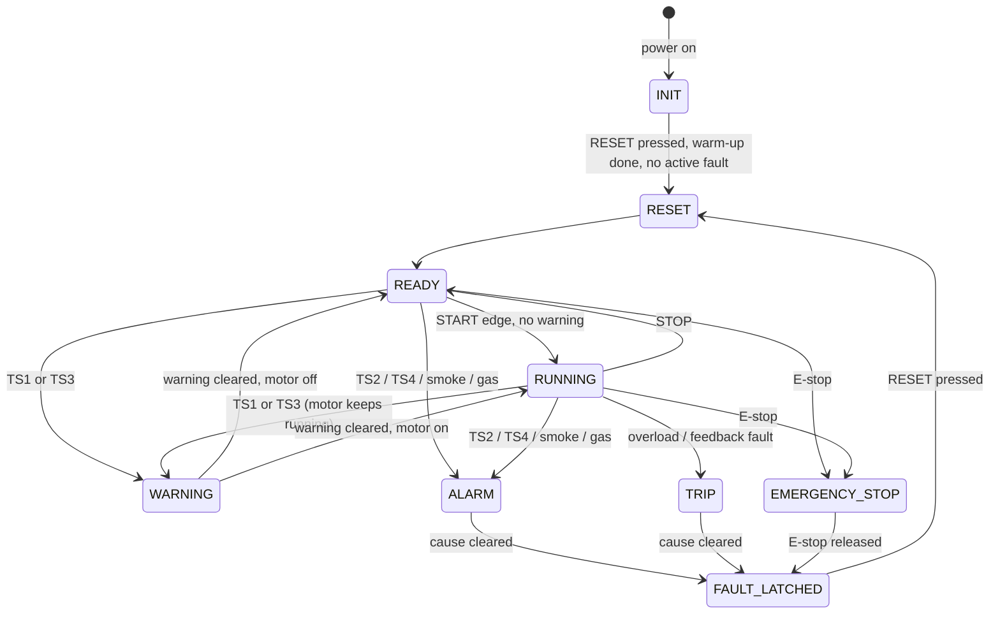

# מכונת המצבים — לוגיקת הבקרה

מסמך זה הוא המפרט. מודל הייחוס בסימולציה (`07_Simulation/reference_model.py`) נכתב ישירות ממנו,
והלדר (`ladder_program.json`) נבדק מולו סריקה־אחר־סריקה.

## עקרונות

1. **אין חזרה אוטומטית.** אחרי תקלה, חירום או הפסקת מתח המנוע לא חוזר לפעול מעצמו.
2. **איפוס אינו הפעלה.** RESET משחרר נעילות בלבד. כדי להפעיל צריך לחיצת START חדשה, ולא באותה סריקה של RESET.
3. **נעילת תקלות.** כל תקלה ננעלת גם אם הסיבה שלה חלפה, ונשארת עד RESET מבוקר.
4. **RESET כשהסיבה עדיין פעילה = אישור בלבד.** הזמזם משתתק, אבל הנעילה נשארת.
5. **תקלה חדשה מפעילה שוב את הזמזם,** גם אם תקלה קודמת כבר אושרה.
6. **החירום ועומס היתר פועלים בחיווט קשיח** על סליל KM1. ה-PLC רק מנטר אותם ומוסיף נעילה והתראה.
7. **ברירת המחדל בעליית מתח היא "בטוח":** כל הזיכרונות מתאפסים, KM1 ו-KM2 מנותקים.
8. **אין כאן ספי בטיחות.** ספי הטמפרטורה, רגישות הגז וזמני הטיימרים הם TBD. הערכים בסימולציה הם ערכי דמה.

## סיבות תקלה

| קבוצה | סיבות | נעילה | השפעה |
|---|---|---|---|
| חירום | `S0` לחוץ (`I4=0`) | `L_ESTOP` | KM1 בחיווט קשיח + ב-PLC, KM2 ב-PLC |
| סכנה | `TS2` או `TS4` (סף התראה), עשן (`IB`), גז (`IC`, רק אחרי החימום) | `L_HAZ` | KM1 ו-KM2 מנותקים |
| מעגל מנוע | עומס יתר (`I5`), מגען שלא נסגר (`T2`), מגע מרותך (`T3`) | `L_MOT` | KM1 מנותק, KM2 נשאר |
| אזהרה | `TS1` או `TS3` (סף אזהרה) | אין נעילה | צהוב; מנוע שפועל ממשיך; התנעה חדשה חסומה |

## המצבים

סדר העדיפויות (החמור מנצח): `EMERGENCY_STOP` ← `ALARM` ← `TRIP` ← `RESET` ← `INIT` ← `FAULT_LATCHED` ← `WARNING` ← `RUNNING` ← `READY`.

| מצב | מתי | KM1 | KM2 | נורות וזמזם |
|---|---|---|---|---|
| `INIT` | אחרי עליית מתח, עד RESET ראשון אחרי סוף החימום | כבוי | כבוי | לבן מהבהב בזמן החימום; בסופו ענבר דולק ("נדרש איפוס") |
| `READY` | מאותחל, אין נעילות, אין תקלות, STOP תקין | כבוי | דולק | לבן דולק |
| `RUNNING` | המנוע קיבל START במצב READY | דולק | דולק | לבן + ירוק (ירוק רק כשיש משוב מ-KM1) |
| `WARNING` | סף אזהרה בטמפרטורה | ממשיך אם פעל; התנעה חסומה | דולק | צהוב |
| `ALARM` | סכנה פעילה: טמפרטורה גבוהה, עשן או גז | כבוי | כבוי | אדום + ענבר + זמזם (עד אישור) |
| `TRIP` | תקלת מעגל מנוע פעילה | כבוי | דולק | ענבר + זמזם (עד אישור) |
| `FAULT_LATCHED` | הסיבה חלפה אבל הנעילה עדיין קיימת | כבוי | כבוי אם הנעילה היא חירום או סכנה | ענבר |
| `RESET` | מצב חולף של סריקה אחת: לחיצת RESET בלי סיבות פעילות | כבוי | — | — |
| `EMERGENCY_STOP` | מפסק החירום לחוץ | כבוי (חיווט קשיח) | כבוי | אדום + ענבר + זמזם (עד אישור) |

## מעברים עיקריים

הערות לתרשים:

- מכל מצב אפשר לעבור ל-`EMERGENCY_STOP`, ל-`ALARM` או ל-`TRIP` (לא כל החצים מצוירים).
- גם ב-`INIT` החיישנים מנוטרים ותקלות ננעלות (תרחיש S20).
- הפסקת מתח מכל מצב מחזירה ל-`INIT` (תרחיש S16).

## משמעות הנורות

| נורה | יציאה | נדלקת כאשר |
|---|---|---|
| לבנה `H2` | `Q4` | READY (כולל ריצה). מהבהבת בזמן החימום |
| ירוקה `H1` | `Q3` | פקודת KM1 **וגם** משוב מהמגען |
| צהובה `H3` | `Q5` | סף אזהרה בטמפרטורה |
| ענברית `H4` | `Q6` | יש תקלה נעולה, או שהחימום הסתיים ועוד לא בוצע RESET ראשון |
| אדומה `H5` | `Q7` | סכנה פעילה עכשיו, או חירום לחוץ עכשיו |
| זמזם `HA1` | `Q8` | תקלה חדשה שטרם אושרה ב-RESET |

ההבהוב מוגבל לזמן החימום בלבד: כל הבהוב הוא פעולה של ממסר היציאה, והבהוב ממושך שוחק אותו.

## רצף איפוס גלאי עשן (אופציונלי)

רבים מגלאי העשן בעלי 4 גידים **נשארים במצב התראה עד ניתוק מתח**. צריך לבדוק את זה בגלאי שנרכש (TBD).
אם הגלאי כזה:

1. RESET בזמן שהגלאי מתריע מתחיל רצף: `Q9` מפעיל את `KA1`, והמגע ה-NC שלו מנתק את הזנת הגלאי למשך `T6`.
2. עד סוף `T7` (ניתוק + התייצבות) נעילת הסכנה לא משתחררת.
3. אם העשן עדיין קיים, הגלאי יתריע שוב כשהמתח חוזר, והמערכת נשארת ב-`ALARM` (תרחיש S09).

אם `KA1` לא מותקן, `Q9` נשאר לא מחובר והרצף רק מעכב את האיפוס בזמן `T7`.

## מגבלות ידועות

- **מפסק חירום חד־ערוצי.** אם ממסר היציאה `Q1` נתקע סגור, החירום עדיין עוצר את המנוע,
  אבל שחרור החירום יחזיר מתח לסליל (תרחיש S15). במתקן אמיתי נדרש ממסר בטיחות עם איפוס ידני מנוטר.
- **ה-PLC אינו בקר בטיחות.** הלוגיקה כאן היא בקרה פונקציונלית לימודית.
- **MQ-2 מוסתר בזמן החימום.** בזמן הזה אין גילוי גז (תרחיש S10).
- **בקרי XH-W3001 אינם fail-safe.** אם מודול מאבד מתח, הממסר שלו פתוח וזה נקרא כ"אין התראה".
